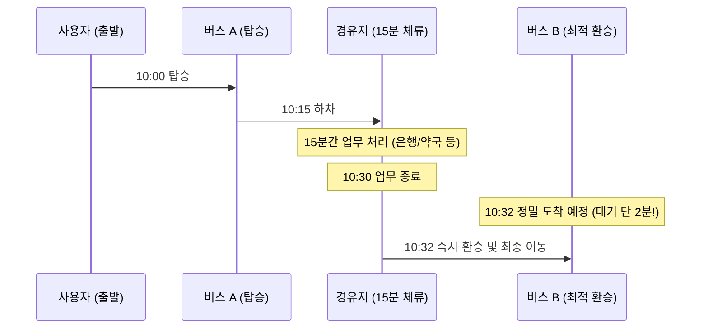

# [MaaS 정책 연구 기획서] G-Route AI 멀티모달 & 대중교통 스케줄링 딥러닝 고도화 방안

본 기획서는 구미시의 지형적 특성 및 대중교통 인프라를 반영하여, 기존 자동차 중심의 G-Route AI를 **① 자전거/도보/공유 PM 멀티모달 확장**, **② 버스 실시간 정밀 시간표 딥러닝 예측**, **③ 대중교통 경유지 스케줄링(15분 체류 시나리오)**으로 확대 고도화하기 위한 머신러닝 설계서입니다.

---

## 1. 경유지(Waypoint) 접목 AI 최적화 알고리즘

기존의 단일 출발지-목적지($S \to T$) 최적화에서 탈피하여, 사용자가 설정한 경유지($W$)를 포함하는 전체 이동 비용을 글로벌하게 최적화합니다.

```
[출발지 S] ──(G-Route AI 우회로)──> [경유지 W] ──(15분 체류)──> [도착지 T]
```

### 🧠 머신러닝 최적화 기법
* **동적 프로그래밍(DP) 결합**: 경유지 $W$가 주어졌을 때, 단순 단일 구간 탐색을 누적하는 것이 아니라 전체 네트워크 가치 함수 $V(s)$를 활용하여 아래 수식을 만족하는 전역 경로를 선택합니다.
  \[\text{Path}^* = \arg\min_{P} \left( \sum_{e \in S \to W} \text{Cost}(e) + \text{DwellTime}(W) + \sum_{e \in W \to T} \text{Cost}(e) \right)\]
* **GNN 노드 임베딩 보정**: 경유지 근처 노드의 활성화 점수(Activation Score)에 가중치를 주어, 경유 직전 노드들의 정체 상황에 맞춘 안전한 진입 각도 및 이면도로 우회 진입로를 모델이 자율 학습하도록 보상 체계를 결합합니다.

---

## 2. [마일스톤 1] 자전거, 도보, 공유플랫폼(PM) 머신러닝 길찾기 확장

정체 가중치 위주인 자동차 도로망과 달리, **경사도(Hill Slope), 전용 도로 유무, 보행 환경 안전도**를 학습 피처로 포함하는 다중 그래프 신경망을 구현합니다.

### 🚲 멀티모달 확장 데이터 피처 설계
| 이동 프로파일 | 핵심 입력 피처 (Node/Edge Features) | 딥러닝 최적화 목표 |
| :--- | :--- | :--- |
| **보행 (도보)** | 인도 유무, 가로등 조도, 보행 신호등 대기 시간 | 안전 안심 보행로 우선 탐색 |
| **자전거** | 자전거 전용도로 여부, 도로 경사도(기하 고도 데이터) | 오르막길 최소화, 안전 가속 경로 |
| **공유 PM** | 자전거 도로 정합도, 요금 경계면, 배터리 소모율(경사 비례) | 전력 효율 극대화 및 지름길 우회 |

### 🛠️ 네트워크 아키텍처 개량
* **ST-GCN (Spatio-Temporal Graph Convolutional Network)**:
  - 구미시 격자망 노드 속성 벡터(5차원)를 **8차원(경사도, 보행 인프라 가중치 포함)**으로 전격 리포맷합니다.
  - 경사가 급한 구미 금오공대 진입로나 형곡동 언덕 구간 등에서 자전거/PM의 소요 시간 및 배터리 방전 속도를 정확히 예측하는 특화된 가속 모델로 컴파일합니다.

---

## 3. [마일스톤 2] 대중교통 배차 시간표 분석 및 15분 체류 환승 스케줄러

공공 API가 제공하는 단순 "N분 후 도착"은 도로 정체 상황에 따른 오차가 큽니다. 전체 운행 이력을 하루 종일 수집/분석하여 정밀한 시각에 정류장에 버스가 안착할 확률을 계산합니다.

### ① 실시간 버스 도착 정밀 시간표 딥러닝 예측 (LSTM/GRU)
* **네트워크 개요**: 각 버스 노선의 정류장별 실시간 운행 통행 속도를 순차 시계열 데이터로 가공하여 LSTM 신경망에 입력합니다.
* **입력 데이터**: [시간대(Hour), 요일(Day), 기상 조건(Rain/Snow), 현재 버스 위치의 정류장 인덱스, 전방 구간 소통 상황]
* **출력 데이터**: 특정 정류장 $Stop_k$에 버스가 도착할 **HH:MM:SS의 정밀한 시계 시각 확률 분포**를 도출합니다.

```
[정류장 간 통행이력 수집] ──> [LSTM/GRU 시계열 예측] ──> [정밀 시각 도착 확률 밀도 함수 산출]
```

### ② 대중교통 경유지 15분 체류 스케줄링 엔진
사용자가 정류장 $Stop_{way}$ 근처 경유지에서 **15분간 머문다**고 가정할 때, 볼일을 보고 나왔을 때 대기 시간 없이 바로 다음 버스(혹은 환승 버스)를 탈 수 있도록 연계하는 Dynamic Scheduling 기법입니다.



* **알고리즘 흐름**:
  1. 출발지에서 경유지 $W$까지 도달하는 버스 A의 예상 도착 시각($T_{arr1}$)을 딥러닝으로 예측합니다.
  2. 체류 시간 15분을 더한 시각인 $T_{free} = T_{arr1} + 15\text{min}$을 산출합니다.
  3. 경유지 정류장을 지나가는 모든 후속 버스 노선들 중, $T_{free}$ 이후에 **가장 먼저 오면서 대기 대기시간(Latency)을 최소화**하는 최적 버스 B의 노선을 딥러닝 시간표 예측 매트릭스에서 즉각 필터링하여 매칭합니다.
  4. 이를 지도 UI상에 타임라인 형태로 시각화하여 최적의 동선을 안심 케어로 제공합니다.

### ③ 신규 철도산업정보센터(KRIC) API 기반 기차-버스 광역 연계 환승 스케줄링
구미시 대중교통 이용객이 대구, 서울 등 타지로 이동할 때 필수 관문인 **구미역(경부선/대경선) 광역 환승 연계**를 머신러닝으로 제어합니다.

```
[시내 버스 이동] ──> [구미역 버스정류장 하차] ──(물리 도보 환승 버퍼 8분)──> [KTX/ITX/대경선 기차 탑승]
```

* **환승 연계 버퍼 타임(Buffer Time) 자동 보정**:
  - 구미역 버스 정류장에서 구미역 기차 승강장(Platform)까지 이동하는 물리적 최소 도보 시간(평균 5~8분)을 AI 휴리스틱 비용에 강제 합산합니다.
  - 기차 출발 시각 $T_{train}$에 대하여, 버스는 반드시 $T_{train} - 10\text{min}$ 이전에 구미역 정류장에 안착하도록 최적 버스 노선 조합을 역산(Back-propagation search)하여 추천합니다.
* **기차 연착률(Delay rate) 예측 접목**:
  - KRIC 역사별 실시간 운행시각표(`stationTimetable`) 및 열차 지연 이력을 크롤링하여 요일/날씨별 연착 패턴을 학습합니다.
  - 기차 연착이 감지될 경우, 사용자가 버스에서 무리하게 서두르지 않도록 다음 순번의 버스를 타게 하거나 경유지 체류 시간을 유연하게 연장(15분 ➡️ 22분)하는 동적 리스케줄링을 활성화합니다.

---

## 4. 고도화 개발 및 실증 로드맵 (Roadmap)

```
[Phase 1] ─────────────────> [Phase 2] ─────────────────> [Phase 3]
멀티모달 고도화             버스 시간표 예측 학습       스케줄링 실증 통합
- 경사 고도 피처 가공       - LSTM 시계열 모델 훈련      - 15분 대기 최적 환승
- PM/도보 GNN 컴파일       - KRIC API 시간표 매핑       - 프론트엔드 타임라인 UI
```

이 고도화 기획서에 따라 다음 세부 개발 태스크를 개설하고 실증 머신러닝 연산을 추진할 준비가 끝났습니다.
