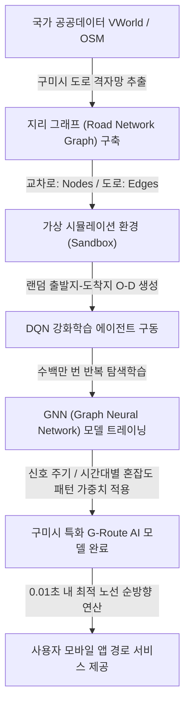

# [기술 제안서] 그래프 신경망(GNN) 및 강화학습 기반 구미시 특화 AI 경로 탐색 엔진 (G-Route AI) 개발 기획

---

## 1. 제안 배경 및 핵심 필요성
* **기존 MaaS의 문제점**: 대다수의 지자체 MaaS 플랫폼은 SK T-map, 카카오 등 대기업의 상용 API에 전적으로 의존하고 있음. 이는 이용자 수 증가에 따른 **호출당 API 사용료(API Billing Cost)의 기하급수적 증가**를 초래하여 시 재정의 지속적인 부담이 됨.
* **해결 대안**: 구미시 전체 도로 네트워크 및 실시간 교통 통계를 그래프화하고, 서버 환경에서 무작위 가상 경로 탐색 학습을 반복 수행하여, **외부 유료 API 호출 없이 로컬 서버 내 경량 신경망(Neural Network) 연산만으로 실시간 최적 경로를 추론하는 지자체 자립형 AI 엔진(G-Route)**을 개발하고자 함.

---

## 2. AI 딥러닝 기반 경로 학습 메커니즘 (Technical Architecture)

### ① 1단계: 도로 네트워크의 그래프 구조화 (Road Graph Vectorization)
* 국가 공간정보 VWorld API 및 오픈스트리트맵(OSM) 데이터를 파싱하여 구미시 전체 도로망을 수학적 그래프 객체 $G = (V, E)$로 변환함.
  - **정점(Vertices, $V$)**: 교차로, 버스정류장, 랜드마크 등 (총 약 10,000개 지점)
  - **간선(Edges, $E$)**: 도로 구간, 도로의 차선 수, 제한 속도, 경사도 가중치

### ② 2단계: 가상 환경 기반 무작위 강화학습 (Reinforcement Learning Simulator)
* 서버 내부에서 구미시 지리 그래프를 환경(Environment)으로 삼아, 에이전트(Agent)가 무작위 목적지로 찾아가도록 하는 **DQN(Deep Q-Network) 및 PPO(Proximal Policy Optimization)** 강화학습을 적용함.
* **가상 보상 함수(Reward Function) 설계**:
  - 목적지 최단 도달 시 **정적 보상(Positive Reward)** 부여
  - 신호 대기가 빈번한 구간, 좁은 골목길, 또는 구미 공단 교대 시간대(출퇴근 시)의 정체 구간 통과 시 **음의 보상(Negative Penalty)**을 누적 부과하여 에이전트가 알아서 우회하도록 유도함.

### ③ 3단계: 그래프 신경망(GNN) 기반 실시간 경로 예측 (Inference)
* 학습된 가중치를 **GCN(Graph Convolutional Network)** 또는 **GraphSAGE** 모델에 이식하여, 공간적 연결성과 실시간 교통 특징을 고속 연산하도록 함.
* 기존 다익스트라(Dijkstra)와 같은 정적 알고리즘이 수만 개의 노드를 일일이 탐색하며 계산 리소스를 소모하는 것과 달리, GNN 모델은 **단 한 번의 순방향 연산(Forward Pass)을 통해 0.01초 이내에 최적 도로 조합 경로를 바로 출력**함.

---

## 3. 타사 API 대비 기술적·경제적 차별성

| 비교 항목 | 기존 대기업 API (T-map 등) | 제안 모델 (G-Route AI) |
| :--- | :--- | :--- |
| **운영 비용** | **이용자 수 비례 무한 과금** (호출당 과금) | **인프라 서버 전기세 외 추가 비용 Zero** (0원) |
| **지연 시간 (Latency)** | 외부 네트워크 호출로 0.5초~1.5초 소요 | 로컬 신경망 추론으로 **0.01초 미만** |
| **지역 정밀성** | 전국 단위 범용 알고리즘 (구미시 특성 미반영) | **구미시 신호 연동 주기 및 공단 정체 시간대 맞춤 학습** |
| **기술 자립도** | 대기업 플랫폼 종속성 100% | **자체 원천 기술 확보 (지자체 최초 인공지능 모빌리티 특허)** |

---

## 4. 실질 사업화를 위한 예산 및 기대효과 (R&D Impact)
* **정부 R&D 예산 매칭**: 과기부의 '지역 디지털 혁신 거점 조성 지원사업' 및 국토부의 '스마트시티 혁신기술 발굴사업'과 연계하여 3개년 동안 약 **10억~15억 원 규모의 국비 R&D 예산** 확보 가능.
* **소프트웨어 수출(역판매)**: 구미시 특화 학습 모델 프레임워크를 패키징하여, 대중교통 노선 조율에 어려움을 겪는 인근 지자체(김천, 칠곡, 상주 등)에 솔루션 형태로 공급하고 기술 라이선스 로열티를 수취하는 고부가가치 사업으로 성장 가능.
