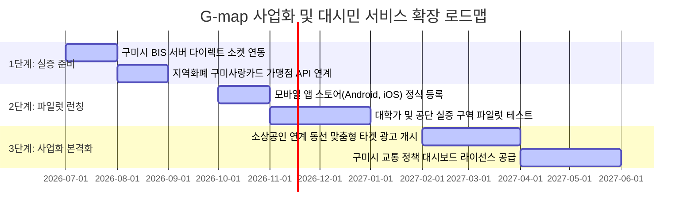

# [실질 사업 기획서] G-map 대시민 서비스화 및 중장기 사업화 고도화 로드맵

---

## 1. 개요
* **배경**: G-map 플랫폼이 공모전 단계를 넘어 구미시 실증/실질 사업으로 선정됨에 따라, 프로토타입 단계의 코드를 안정적인 대시민 모빌리티 서비스(MaaS)로 확장하고 공공 및 민간 차원의 중장기 비즈니스 모델(BM)을 확립하여 지속 가능한 자립형 플랫폼으로 고도화하고자 함.

---

## 2. 4대 핵심 사업 고도화 전략

### ① 기술적 고도화 및 데이터 파이프라인 신뢰성 강화 (Scale-up)
* **구미시 버스정보시스템(BIS) 직접 연동 (Latency 4초 ➡️ 0.5초 단축)**:
  - 현재 공공데이터포털(TAGO) API 폴링 방식의 한계를 극복하기 위해, **구미시 교통행정과와 협의하여 구미시 BIS 웹소켓(WebSocket) 또는 gRPC 다이렉트 채널을 개설**함. 이를 통해 초정밀 0.5초 단위 버스 위치 스냅핑 기술을 구현함.
* **하이브리드 앱 네이티브 고도화 및 온디바이스(On-Device) AI 탑재**:
  - Capacitor 환경을 고도화하여 모바일 OS(Android, iOS)의 위치 정보 센서(GPS), 자이로스코프 센서와 정밀 결합하여 음영 구역 도보 안내 성능을 강화함.
  - 서버 비용(API 호출료) 절감과 응답 속도 향상을 위해, 경량형 소형언어모델(SLM)을 앱 내에 로컬 탑재하여 간단한 교통 명령은 서버 통신 없이 즉각 구동하는 온디바이스 AI 체계로 전환함.

### ② 지역 밀착형 비즈니스 모델(BM) 및 로컬 상권 연계
* **구미사랑카드 가맹점 연계 'O-D(기종점) 맞춤형 타겟 마케팅 서비스'**:
  - 승객의 이동 출발지(O)와 목적지(D) 정보를 실시간 분석하여, 이동 경로 상의 소상공인 맛집/카페와 연동한 **'스마트 혜택 배너 오버레이'**를 송출함.
  - 예: "현재 탑승하신 11번 버스의 경유 정류장 근처 카페에서 구미사랑카드 결제 시 사용 가능한 10% 추가 할인 쿠폰 발급". 단순 무작위 광고가 아닌, 승객의 이동 동선 밀착형 광고 플랫폼으로 소상공인과의 상생 BM을 구축함.
* **통합 마일리지(MaaS 토큰) 제도 도입**:
  - 버스 이용 후 공유 PM이나 택시로 환승 시 마일리지를 적립해 주고, 이를 구미사랑카드 적립금이나 제휴 PM 업체 할인권으로 전환할 수 있는 통합 멤버십 환경을 설계하여 대시민 리텐션(재방문율)을 확보함.

### ③ 대중교통 음영 구역 극복을 위한 "초소형 모빌리티 허브" 확장
* **수요응답형 행복버스(DRT) 실시간 다이내믹 라우팅(Dynamic Routing) 적용**:
  - 현재 행복버스의 단순 호출/사전 예약제를 넘어, 실시간 호출 요청 위치들을 분석하여 실시간으로 승하차 노선을 재계산하는 **'실시간 AI 동적 배차 알고리즘'**을 도입함.
  - 대중교통 인프라 만족도 저하(45.2% 보통 이하)를 보이는 변두리 공단 구역과 농촌 지역의 실질적 교통 복지를 실현함.
* **디지털 취약계층용 '스마트 쉘터(Smart Shelter)' 터치 키오스크 연계**:
  - 모바일 기기 사용이 어려운 고령층을 위해 구미시 내 주요 환승 정류장에 G-map 연동형 스마트 키오스크를 배치하여, 대화형 AI를 통해 정류장에서 바로 버스 노선을 확인하고 행복버스를 호출할 수 있는 공공 배리어 프리(Barrier-free) 인프라로 확장함.

### ④ 행정/학술 라이선스 공급 (DaaS: Data as a Service)
* **구미시 대중교통과 전용 '교통 빅데이터 분석 대시보드' 정식 라이선스 공급**:
  - 기구현된 MaaS 시뮬레이터(research_tab.js)의 가상 노선 작도, 노선 굴곡도 및 생산성 평가 엔진을 구미시 행정망과 연동하여 **'데이터 기반 교통 행정 솔루션'**으로 라이선스를 판매함.
  - 매년 수억 원이 소요되는 구미시 시내버스 노선 조율 및 개편 용역 작업을 본 플랫폼의 실시간 수집 빅데이터 대시보드로 대체하여 시 예산 감축에 직접적으로 기여함.

---

## 3. 중장기 추진 로드맵 (단계별 실행 계획)

