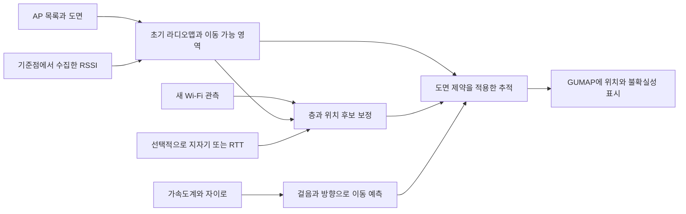

테크노관 Wi-Fi 실내 측위 문헌 검토 및 GUMAP 적용안

검토일: 2026-09-08. 사용자가 확보 가능한 정보는 AP의 설치 층·위치·모델·BSSID 목록이다. 아직 실제 AP 목록, 현장 신호 데이터, 지원 단말 목록은 받지 않았다. 아래 성능 목표와 구현 순서는 테크노관을 위한 제안이며 현장 검증 결과가 아니다.

**판단: 구현할 수 있는 기술적 기반은 있다. 첫 실험은 기존 AP의 RSSI 핑거프린트 + 보행자 추측 항법(PDR) + 도면 제약으로 진행하는 것이 적합하다.** AP 모델이 RTT를 지원하면 별도 비교 후보로 올린다. CSI와 완전 비지도 라디오맵 구축은 초기 구현의 필수 조건으로 두지 않는다. 여기서 추적 대상은 GUMAP을 실행하고 센서 사용을 허용한 사용자의 스마트폰이다. AP 목록은 고정 설비 정보이므로, 그것만으로 사람의 현재 좌표를 얻을 수는 없다.

**논문을 확인한 범위**

사용자가 적은 항목에는 정확한 논문명, 연구 방향 설명, 서로 다른 판본의 성능 수치가 섞여 있었다. 다음처럼 구분했다. 확보하지 못한 학술지 전문까지 모두 읽었다고 간주하지 않았다.

| 요청 항목 | 확인한 문헌과 서지 정리 | 이번 확인 범위 |
|---|---|---|
| 비지도 크라우드소싱 | Suk-Hoon Jung, Byung-Chul Moon, Dongsoo Han, *Unsupervised Learning for Crowdsourced Indoor Localization in Wireless Networks*, IEEE TMC 15(11), 2892–2906, 2016. DOI 10.1109/TMC.2015.2506585 | KAIST 서지·초록 확인. 원 논문 전문 미확보. 같은 저자들의 2017/2018 후속 논문에서 UCMA 설명과 실험을 추가 확인 |
| KAILOS | Dongsoo Han, Sangjae Lee, Sunghoon Kim, *KAILOS: KAIST Indoor Locating System*, IPIN 2014, 615–619. DOI 10.1109/IPIN.2014.7275535 | 원 학회 논문 초록 확인. 별도로 공개된 동명 2쪽 저자 요약문 전문 확인. 이 요약문의 저자는 Han, Jung, Lee로 원 학회 판본과 다름 |
| 주소 기반 라디오맵 | Dongsoo Han, Byeongcheol Moon, Giwan Yoon, *Address-Based Crowdsourcing Radio Map Construction for Wi-Fi Positioning Systems*, IPIN 2014, 58–67. DOI 10.1109/IPIN.2014.7275468 | 저자 공개 웹 전문에서 수집·군집화·주소 부착·평가·결론 확인 |
| 체류/전이 공간 | 독립된 논문 제목으로 특정되지 않음 | KAIST 공식 연구 소개에서 체류 공간의 주소 라벨링과 이동 공간의 비지도 학습을 결합하는 연구 방향 확인 |
| 적응형 하이브리드 필터 | Namjun Park, Sukhoon Jung, Dongsoo Han, *An adaptive hybrid filter for practical WiFi-based positioning systems*, ICT Express 1(2), 82–85, 2015. DOI 10.1016/j.icte.2015.09.008 | KAIST 초록과 공개된 첫 1쪽 확인. 전체 4쪽 전문 미확보. 세부 수식과 전체 평가를 확인한 것으로 보지 않음 |
| CSI 다중 뷰 학습 | Minseuk Kim, Changjun Kim, Dongsoo Han, June-Koo Kevin Rhee, *Multiview Variational Deep Learning with Application to Scalable Indoor Localization*, arXiv:2008.10812, 2020 | 10쪽 프리프린트 전문, 실험 조건과 결과 표 확인 |
| 위 연구의 학술지 판본 | Minseuk Kim, Dong-Soo Han, June-Koo Kevin Rhee, *Multiview Variational Deep Learning With Application to Practical Indoor Localization*, IEEE IoT Journal 8(15), 12375–12383, 2021. DOI 10.1109/JIOT.2021.3063512 | KAIST 서지·초록 확인. 학술지 전문 미확보 |
| PDR + Wi-Fi + HMM | Dongsoo Han, Suk-hoon Jung, Sangjae Lee, *A sensor fusion method for Wi-Fi-based indoor positioning*, ICT Express 2(2), 71–74, 2016. DOI 10.1016/j.icte.2016.04.002 | 4쪽 전문과 융합 구조·평가 확인. 사용자의 일반적인 연구 설명에 대응하는 구체적 논문 |
| 추가로 검토한 유지관리 연구 | Suk-Hoon Jung, Dongsoo Han, *Automated Construction and Maintenance of Wi-Fi Radio Maps for Crowdsourcing-Based Indoor Positioning Systems*, IEEE Access 6, 1764–1777, 2018, 온라인 공개 2017. DOI 10.1109/ACCESS.2017.2780243 | 저자 공개 웹 전문에서 UCMA, 증분 갱신, AP 변화 실험, 장기 실험, 결론 확인 |
| 먼저 요청한 로컬 PDF | *ILoA: Indoor Localization Using Augmented Vector of Geomagnetic Field*, IEEE Access, 2020. DOI 10.1109/ACCESS.2020.3029281 | `000583557200001.pdf` 16쪽 원고 확인. Wi-Fi 자체 측위 논문이 아니라 지자기·PDR 융합 연구 |

**각 연구에서 가져올 부분과 적용 한계**

1. **UCMA: 도면을 이용해 라벨이 없는 Wi-Fi 측정열의 위치를 추정한다.** HMM으로 가능한 이동을 표현하고, 전파 모델·AP 위치 등에 대한 전역 탐색과 국소 학습을 결합한다. 비지도라는 말은 현장 데이터가 필요 없다는 뜻이 아니다. 유사한 복도가 반복되면 위치 대응도 모호해질 수 있다. 테크노관에서는 이미 아는 AP 좌표를 고정하거나 오차 범위로 제한하고, 일부 실제 기준점을 제공하는 변형이 합리적이다. 이는 이번 적용 제안이며 원 논문에서 테크노관 조건으로 검증된 결과는 아니다. [TMC 서지·초록](https://pure.kaist.ac.kr/en/publications/unsupervised-learning-for-crowdsourced-indoor-localization-in-wir/), [저자 후속 논문의 UCMA 설명](https://www.researchgate.net/publication/321638320_Automated_Construction_and_Maintenance_of_Wi-Fi_Radio_Maps_for_Crowdsourcing-Based_Indoor_Positioning_Systems)

2. **KAILOS와 센서 융합: 실시간 추적의 기본 구조로 가장 직접적이다.** Wi-Fi와 지자기의 관측을 위치 후보별로 평가하고, 관성 센서와 도면으로 이동 가능성을 계산한다. 확장 비터비 알고리즘은 이동 거리·방향의 누적 오차도 보정한다. 2016 논문은 KAIST N1 7층 실험에서 Wi-Fi만 사용할 때 평균 오차 2–3m, 센서 융합 시 1m 미만을 보고한다. Wi-Fi는 초기 위치, 지자기는 수렴 후 추적, 관성 센서는 방향 변화에 기여했다. 이 결과는 특정 실험이며 테크노관의 보장 성능이 아니다. [KAILOS 학회 서지](https://pure.kaist.ac.kr/en/publications/kailos-kaist-indoor-locating-system/), [별도 저자 요약문](https://www.microsoft.com/en-us/research/wp-content/uploads/2015/10/han.pdf), [2016 센서 융합 전문](https://csrms.kaist.ac.kr/files/thesis/1bc9434578275e05bb9174033fe00adc.pdf)

3. **주소 기반 연구: 강의실·연구실의 공간 라벨을 얻는 데 응용할 수 있다.** 집·직장 주소로 체류 중 수집한 신호에 장소를 부여하는 발상이다. 평가 범위는 주거·도심 지역이며, 수집률 50%에서 세 지역의 평균 오차는 10m 이하였지만 갤러리아 지역은 약 20m였다. 논문도 복도와 열린 공간을 이 방식만으로 채울 수 없다고 명시한다. 테크노관의 “301호 안”은 방 영역 라벨로 쓸 수 있지만 모든 샘플의 정답을 301호 중심 좌표로 지정하면 안 된다. 정확한 점 라벨은 출입문 옆 기준점처럼 위치를 실제로 확인한 곳에서 얻는다. [주소 기반 논문](https://www.researchgate.net/publication/267950367_Address-Based_Crowdsourcing_Radio_Map_Construction_for_Wi-Fi_Positioning_Systems)

4. **체류/전이 공간 구분: 하나의 건물에서 수집 전략을 달리하자는 의미로 적용한다.** 연구실·강의실은 확인된 공간 라벨을 활용하고, 복도는 이동 궤적과 기준점으로 학습한다. KAIST가 2017년에 소개한 3–4m는 충분한 학습 데이터를 사용한 해당 실험의 수치다. 2017년 소개 기사와 2016년 TMC 출판연도를 혼동하면 안 된다. [KAIST 공식 연구 소개](https://news.kaist.ac.kr/newsen/html/news/?GotoPage=1&list_e_date=&list_s_date=&mng_no=4474&mode=V&skey=keyword&sval=IEEE+Transactions+on+Mobile+Computing)

5. **적응형 하이브리드 필터: 위치의 튐을 줄이는 비교 후보이다.** 확인된 내용은 지도 그래프와 소수의 파티클, 측정값과 예측값의 적응적 결합이다. 단순한 RSSI 이동평균 필터로 요약하기 어렵다. 다만 이번에는 전체 전문을 확보하지 못했으므로 세부 알고리즘을 재현했다거나 다른 필터보다 우수하다고 판정하지 않는다. 첫 구현에서는 단순한 RSSI 기준 모델과 지도 제약 융합 모델부터 비교한다. [학술지 서지·초록](https://pure.kaist.ac.kr/en/publications/an-adaptive-hybrid-filter-for-practical-wifi-based-positioning-sy/), [공개 첫 페이지](https://csrms.kaist.ac.kr/files/thesis/a25d11e193cfeb473744f52fd2fd3ded.pdf)

6. **VSDL: 0.77m를 일반 스마트폰의 예상 오차로 인용하면 안 된다.** 2020 초고는 Intel 5300 기반 수신 노트북 7대와 송신 노트북, 각각 7m인 두 복도, 학습 위치 43개·시험 위치 9개 등으로 실험했다. 위치 라벨을 사용하는 지도학습이며, 다중 수신 CSI에서 유효한 뷰를 선택해 좌표를 추정한다. 결과 표는 평균 오차 0.7715m다. 제목과 저자 구성이 바뀐 2021 학술지 초록은 1.28m를 보고한다. 판본 간 차이의 원인은 최종 전문 없이는 단정할 수 없다. 일반 BSSID/RSSI 스캔으로 이 실험의 CSI를 얻을 수 없으므로 별도 장비·펌웨어 지원이 확인될 때 연구 분기로 검토한다. [2020 전문](https://arxiv.org/pdf/2008.10812), [2021 학술지 기록](https://koasas.kaist.ac.kr/handle/10203/287245?mode=simple)

7. **자동 유지관리: 초기 구축 이후에 중요하다.** 후속 연구는 AP 추가·삭제와 시간에 따른 변화를 반영해 라디오맵을 갱신했다. 20주 실험에서 자동 갱신의 이점이 있었지만, 수동 구축한 초기 맵에 비지도 갱신을 적용하면 평균 오차가 약 1.75m에서 약 2.1m로 나빠지는 사례도 있었다. 테크노관에서는 추정 궤적을 곧바로 정답으로 저장하지 않고, 별도 기준점 검증을 통과한 새 맵만 배포해야 한다. 기종 차이도 별도 검증 대상이다. [유지관리 논문](https://www.researchgate.net/publication/321638320_Automated_Construction_and_Maintenance_of_Wi-Fi_Radio_Maps_for_Crowdsourcing-Based_Indoor_Positioning_Systems)

8. **ILoA: RSSI로 대략적인 위치를 잡은 다음 지자기 추적으로 확장할 근거이다.** 로컬 원고의 증강된 지자기 벡터와 PDR·파티클 필터를 참고할 수 있다. 표 1의 선택된 설정에서는 N1 평균 오차 0.42m, KI 1.30m지만, 사전 자기장 지도와 초기 수렴 과정이 있다. 논문의 precision은 자체 정의된 궤적 수렴 지표여서 일반적인 “모든 위치를 100% 맞힘”으로 해석하면 안 된다. 테크노관에서는 자력계 로그를 첫 조사 때 함께 모아 두고 RSSI+PDR 대비 추가 효과를 나중에 평가하는 편이 효율적이다. 근거: 사용자가 지정한 `000583557200001.pdf`, 평가 및 표 1.

**AP 목록이 해 주는 일**

| 확보 정보 | 실제 활용 | 이것만으로 알 수 없는 것 |
|---|---|---|
| 설치 층 | 층 후보의 사전 정보, 위·아래층 전파 혼동 분석 | 사용자의 층. 다른 층 AP도 강하게 잡힐 수 있음 |
| 설치 위치 | 도면상의 AP 배치, 전파 모델 초기값, RTT 거리 측정의 기준 좌표 | 벽·문·사람·방향을 반영한 실제 RSSI 분포 |
| 모델 | 제조사 문서로 RTT/FTM·CSI 추출 가능성 검토 | 현장 펌웨어·설정에서 실제 기능이 켜져 있는지 |
| BSSID | 휴대폰이 관측한 신호와 설치 AP의 대응 | 그 순간 사용자의 위치·이동 방향 |

목록을 받을 때는 **물리 AP 한 대와 그 AP의 여러 BSSID를 연결한 형태**가 좋다. 관리 MAC만 있는지, 각 무선 인터페이스·SSID의 실제 송출 BSSID인지 확인한다. 같은 SSID를 사용하는 여러 AP는 BSSID로 구별한다. 한 물리 AP의 여러 가상 BSSID를 독립적인 여러 위치 기준점으로 과대평가하지 않도록 묶음 정보도 유지한다.

우선 필요한 열은 `physical_ap_id, floor, x, y, coordinate_system, model, bssid`다. 설치 위치가 도면 표시로 제공되면 기존 도면 좌표로 옮기면 된다. 여러 BSSID는 같은 물리 AP ID로 여러 행에 둔다. 추가로 받을 수 있다면 `band/frequency, firmware, mounting_height, last_verified_at`을 기록한다. 송신 출력 자동 조정·채널 변경 정책은 유지관리 분석에 도움이 되지만 첫 조사 시작의 필수 조건은 아니다.

**실시간 추적에 필요한 구조**

Wi-Fi 스캔이 올 때 위치 후보를 보정하고, 그 사이에는 PDR로 이동을 예측한다. 복도·문·계단 연결을 활용해 벽을 통과하는 후보를 제거한다. 위치가 모호하면 후보를 여러 개 유지하며, 새 관측 없이 시간이 흐르면 불확실성을 늘린다. 지도에 점을 자주 그리는 것과 정확한 절대 위치를 자주 측정하는 것은 다르다.

Android 공식 문서상 일반 앱의 능동 Wi-Fi 스캔은 전경에서 2분당 4회, 모든 배경 앱을 합쳐 30분당 1회로 제한된다. 시스템 등이 수행한 스캔을 수신할 수 있어도 일정한 주기가 보장되지는 않는다. `getScanResults()`가 이전 결과를 반환할 수 있으므로 새 관측 여부와 측정 시각을 기록해야 한다. 따라서 매초 새 RSSI를 받는 것을 전제로 설계하면 안 된다. 조사용 개발 단말에서 제한을 해제한 실험은 가능하지만, 서비스 평가는 제한을 켠 실제 사용 조건으로 수행해야 한다. [Android Wi-Fi 스캔 문서](https://developer.android.com/develop/connectivity/wifi/wifi-scan)

RTT는 신호 세기를 거리로 바꾸는 방식과 다르다. 지원 AP와 지원 스마트폰이 필요하며, AP 좌표를 알고 있어야 거리들로 위치를 계산할 수 있다. 공식 문서는 세 개 이상의 AP 거리로 통상 1–2m를 설명하지만, 테크노관에서 벽·배치·측정 성공률을 확인해야 한다. RTT 거리 측정에는 일반 스캔과 다른 제한이 적용된다. AP 모델 확인 → 단말 지원 확인 → 현장 ranging 성공률 확인 순서로 후보 여부를 결정한다. [Android RTT 문서](https://developer.android.com/develop/connectivity/wifi/wifi-rtt)

iOS는 일반 앱에 주변 Wi-Fi 전체를 스캔하는 범용 API를 제공하지 않는다. 따라서 같은 RSSI 수집 방식을 그대로 이식하는 계획은 잡지 않는다. 첫 실험은 Android 앱을 대상으로 하고, iOS 지원은 별도의 위치 입력 방식을 정해야 한다. [Apple TN3111](https://developer.apple.com/documentation/technotes/tn3111-ios-wifi-api-overview)

**현재 GUMAP에서 재사용할 것과 새로 만들 것**

작업 폴더의 `GUMAP-개발/floorplan/fp/nav.py`에는 층별 복도·방 폴리곤, 문과 계단·엘리베이터 연결, 픽셀과 미터의 변환 정보가 있다. 이것은 지도 제약과 층간 이동 판단에 활용할 수 있다. `GUMAP-앱/capacitor.config.json`에는 Capacitor 앱 구성이 있다. 이번에 확인한 소스 범위에서는 Wi-Fi·PDR 수집 모듈을 찾지 못했으므로 해당 기능은 추가 작업으로 본다. APK 내부 기능까지 검증한 것은 아니다.

현재 길찾기 그래프는 최단경로 계산을 위한 가시성 그래프다. 꼭짓점만을 사용자 위치 후보로 삼으면 긴 복도 중간의 위치를 표현할 수 없다. 기존 폴리곤을 이용하되, 측위용으로는 연속 파티클 또는 충분히 조밀한 상태점을 별도로 만든다. 방 내부 후보와 출입문 연결도 포함한다. 추천 경로 위로 무조건 위치를 붙이면 사용자가 잘못 들어선 경우를 놓칠 수 있으므로 실제 보행 가능 영역을 기준으로 추적한다.

센서 처리의 내부 좌표는 미터로 통일하고, 표시할 때 기존 도면 좌표·지리 좌표로 변환한다. 도면의 y축 방향과 센서 방위각 기준도 맞춰야 한다. `route.py`의 층고 4m는 경로 비용 계산에 쓰는 설정값이므로 실제 층고 측정값으로 간주하지 않는다.

구현은 다음 세 부분으로 나누는 것이 적합하다.

- **Android 수집·추적:** Wi-Fi 관측과 관성 센서를 단조 증가 시각 기준으로 정렬하고, 보행 예측·지도 제약·새 관측 보정을 수행한다. 정지 감지와 방향·보폭 오차도 관리한다. 첫 버전은 휴대폰을 손에 들고 안내 화면을 보는 사용을 대상으로 명시한다.
- **오프라인 학습:** 기준점·조사 경로로 라디오맵을 만들고, 기종·날짜를 나눈 로그로 모델을 비교한다. 원본 관측, 사람이 확인한 라벨, 자동 추정 라벨을 구별해서 저장한다.
- **GUMAP 표시:** `floor, x_m, y_m, timestamp, uncertainty, tracking_state, map_version`을 받아 위치를 그린다. 낮은 확신에서는 영역과 재탐색 상태를 표시한다. 검증되지 않은 uncertainty 숫자를 95% 신뢰반경이라고 부르지 않는다.

**한 층에서 시작하는 구체적 실험안**

1. **현장 입력과 단말 확인.** AP 목록을 도면에 올리고 Android 단말 두 기종 이상에서 실제 관측 BSSID와 대조한다. 새 스캔의 간격·성공률, 관성 센서 제공 여부, 가능하면 RTT 응답 여부를 기록한다. AP 개수 자체보다 복도·방에서 동시에 관측되는 신호와 공간별 구별 가능성이 중요하다.
2. **기준점과 이동 경로 수집.** 한 층의 입구, 계단·엘리베이터 앞, 복도 분기점, 일부 방 출입문에 우선 6–10개 기준점을 둔다. 이는 출발용 제안이지 충분한 커버리지의 보증이 아니다. 기준점 사이를 양방향으로 반복 보행하고 중간 확인 위치를 기록한다. 긴 복도·로비·유사한 구간은 기준점을 추가한다. 바로 위·아래층의 계단 주변도 함께 수집해 층 혼동을 평가한다.
3. **측정 품질 확보.** 기준점마다 다른 방향·시간대에서 새 스캔 10–20개를 모으는 것을 초기 목표로 삼는다. 제한이 켜진 단말에서는 시간이 걸리므로 같은 캐시를 반복 저장해 수를 채우지 않는다. PDR로 보간한 위치는 오차가 있는 라벨로 표시한다. 지자기와 기압은 제공되는 단말에서 함께 수집한다.
4. **단순한 기준 모델부터 비교.** 가장 강한 AP 기준 위치를 하한선으로 두고, RSSI 가중 최근접 이웃(WKNN), RSSI+PDR+도면 제약을 같은 로그로 비교한다. AP 좌표 기반 전파 모델은 초기 후보를 주는 보조 수단으로 평가하고, 이를 실제 측정 라디오맵과 동일하게 취급하지 않는다.
5. **이동·층 전환 검증.** 직진, 회전, 정지, 되돌아가기, 잘못된 갈림길, 방 출입, 계단·엘리베이터 이동을 시험한다. 층은 여러 AP의 관측과 이동 이력을 함께 판단하고, 기압은 상대 변화로 보조한다. 가장 강한 AP의 설치 층으로 즉시 바꾸지 않는다.
6. **효과가 확인된 확장만 추가.** 지자기가 RSSI+PDR의 오차를 줄이면 정식 관측으로 넣는다. RTT 지원과 성능이 확인되면 동일 조건에서 비교한다. 이후 다른 층을 확장하고, 자발적으로 제공된 사용자 로그로 자동 갱신 후보를 생성한다. 검증용 고정 로그를 통과한 버전만 배포하고 이전 버전으로 되돌릴 수 있게 한다.

**성공 여부를 판단할 기준**

아래 수치는 논문에서 가져온 테크노관 예상 성능이 아니라, 초기 개발을 판단하기 위한 잠정 목표다. AP와 실측 데이터 확인 후 조정해야 한다.

| 항목 | 기록 및 잠정 판정 기준 |
|---|---|
| 평면 위치 | 정답 층 조건에서 중앙값 3m 이하, P90 6m 이하를 초기 목표로 검토. 평균·P95도 함께 기록 |
| 층 | 정확히 같은 층의 비율 95% 이상을 초기 목표로 검토. 층 전환 구간의 오판 지속 시간도 별도 기록 |
| 잘못된 안내 | 분기점 오인, 벽 반대쪽 표시, 방 잘못 진입 판정을 따로 집계. 거리 평균만으로 서비스 통과를 결정하지 않음 |
| 실시간성 | 처음 유효한 위치가 나올 때까지의 시간, 새 Wi-Fi 관측 간격, 추적 불능 시간 비율, 센서→화면 지연 기록 |
| 일반화 | 학습하지 않은 날짜·기종·사용자·경로에서 평가. 동일 위치의 연속 패킷을 무작위 분할한 결과만 사용하지 않음 |
| 운영성 | 내비게이션 실행 중 배터리 소모, 휴대 자세 변화, AP 출력·구성 변화 후 성능 확인 |

층을 맞힌 샘플만의 평면 오차를 보고할 때는 틀린 층과 추적 실패를 전체 분모에서 숨기지 않는다. 최소한 전체 실패율과 층 정확도를 함께 제시한다. 사람이 표시한 기준점 통과 시각 등 독립적인 정답을 사용하며, 모델 자신의 추정 위치를 시험 정답으로 사용하지 않는다.

**현재 결정할 수 있는 것**

AP 교체나 CSI 장비 구매를 전제로 하지 않고, 제공 가능한 AP 목록과 기존 도면으로 Android 한 층 실험을 시작할 수 있다. 우선 확인해야 할 불확실성은 테크노관에서의 실제 RSSI 구별 가능성, 일반 단말의 관측 간격, 층간 혼동, 휴대 자세에 따른 PDR 오차다. 이 네 가지를 측정하면 기존 AP만으로 길안내 수준을 달성할지, RTT·지자기 보강이 필요한지를 구체적으로 판단할 수 있다.

이 문서는 문헌 검토와 설계안이다. 현장 측정, 측위 모듈 구현, 성능 시험은 아직 수행하지 않았다. 학술지 전문을 확보하지 못한 UCMA 원 논문, KAILOS 원 학회 판본, 2015 하이브리드 필터, 2021 VSDL 판본의 세부 재현 검토는 남아 있다.
