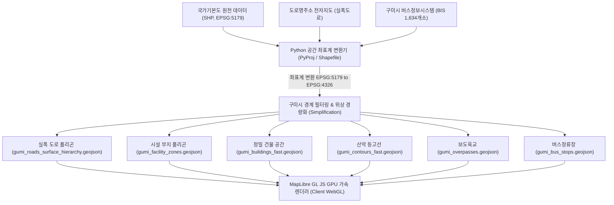
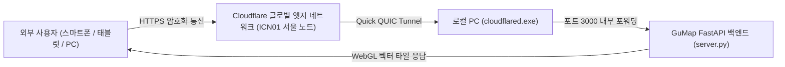

# 📘 [기술 보고서] GuMap 자체 벡터 지도(Vector Map) 구축 아키텍처 및 구현 상세 보고서

---

## Executive Summary (개요)

본 보고서는 **구미시 통합 모빌리티 지도(GuMap)**가 기존 상용 포털(네이버, 카카오) 및 공공 래스터 타일(Vworld, OpenStreetMap)에 의존하지 않고, **국가 원천 공간정보 데이터를 기반으로 자체 WebGL GPU 가속 벡터 지도(Vector Map)를 독립 구축한 전 과정**을 체계적으로 정리한 기술 보고서입니다.

GuMap의 벡터 지도는 단순한 배경 이미지를 타일 단위로 받아 보여주는 기존 래스터(PNG) 지도와 달리, **도로의 실제 폭, 건물의 3D 공간 형상, 지적 부지 경계, 등고선, 대중교통 인프라 좌표를 클라이언트 웹 브라우저의 GPU(WebGL)가 실시간으로 직접 연산하여 그려내는 차세대 웹 지도 시스템**입니다.

---

## 1. 래스터 지도(Raster) vs GuMap 벡터 지도(Vector) 비교

| 비교 항목 | 기존 래스터 지도 (Vworld / OSM / 일반 타일) | GuMap 자체 벡터 지도 (MapLibre GL GPU) |
| :--- | :--- | :--- |
| **렌더링 방식** | 서버가 미리 잘라둔 사각형 이미지(PNG/JPEG) 전송 | GeoJSON 벡터 원천 좌표를 **브라우저 GPU 셰이더**가 직접 렌더링 |
| **확대/축소 품질** | 확대 시 글자 및 도로 테두리가 깨지거나 흐려짐 (Pixelation) | **무한 확대(Infinity Zoom)** 시에도 벡터 곡선 및 텍스트 100% 선명 |
| **도로 표현** | 단순한 실선(Line) 또는 고정된 그림 | **실제 아스팔트 폭(실폭) 면(Polygon)** 기반 포스트잇 입체 표현 |
| **인프라 상호작용** | 지도 이미지를 클릭해도 건물/도로 정보 추출 불가 | **건물 및 도로 면 클릭 시 ID, 층수, 실내도 연동, 길찾기 즉각 반응** |
| **디자인 커스텀** | 서버가 주는 고정 색상만 사용 가능 (변경 불가) | 스타일 명세서(`gumap-style-spec.js`)를 통해 **색상/두께 밀리초 단위 튜닝** |
| **서버 부하** | 지도 이동할 때마다 수십~수백 장의 이미지 타일 요청 | 최초 로드 후 **로컬 캐시 및 GPU 메모리 활용으로 트래픽 대폭 절감** |

---

## 2. GIS 데이터 엔지니어링 및 파이프라인 (Data Pipeline)

GuMap 벡터 지도는 국토지리정보원 국가기본도, 도로명주소 전자지도, 구미시 BIS 데이터를 직접 정제·가공하여 11개의 경량 벡터 레이어로 구축되었습니다.



### 1) 실폭 도로 아스팔트 면 폴리곤 (`gumi_roads_surface_hierarchy.geojson`, 32.7MB)
- **개념**: 기존 전자지도는 도로를 두께 없는 1차원 선(Line)으로 취급하지만, GuMap은 차량이 실제로 주행하는 **아스팔트 포장 면 전체를 2차원 폐곡선(Polygon)**으로 추출했습니다.
- **분류 체계**:
  - 고속도로/도시고속 (`cls: 1`): `#ffa03d` (주황)
  - 주요 간선도로/대로 (`cls: 2`): `#fdd835` (골드 옐로우)
  - 보조간선/소로/골목길 (`cls: 4`, `8`): `#ffffff` (화이트 아스팔트)
- **은은한 외곽선(Casing)**: 도로 끝자락 경계선에 뉴트럴 슬레이트(`#94a3b8`) 컬러와 축척 연동 두께(`0.6px ~ 1.5px`)를 적용하여 도로 면이 주변 부지와 자연스럽게 분리되도록 구현.

### 2) 시설 부지(Site Parcel) 및 건물 카토그래피 혁신 (`gumi_facility_zones.geojson`, 1.39MB)
- **원천 데이터**: 국가기본도 시설구역경계(`TN_FCLTY_ZONE_BNDRY.shp`)
- **구미시 전역 1,972개 시설 부지 추출**:
  - `FAA701` (아파트 단지 부지 602개소): 웜 베이지 (**`#f5ebe1`**)
  - `FAA101`~`FAA106` (초·중·고·대학교 부지 202개소): 소프트 스카이블루 (**`#e3ecfb`**)
  - `FAA001`~`FAA009` (공공청사/관공서 115개소): 라벤더 그레이 (**`#f0f4f8`**)
  - `FAA313` (운동장/체육시설 4개소): 소프트 그린 트랙 (**`#e4f0e2`**)
  - `FAA505` (종합병원 부지 19개소): 소프트 틴트 (**`#fef2f2`**)
- **핵심 카토그래피 원칙 (네이버/카카오 지도 스타일 구현)**:
  - 기존에는 건물 지붕에 색을 칠해 지도가 난잡해지는 문제가 있었습니다.
  - GuMap은 **"건물 밑의 토지/부지(Site Parcel)에 구역별 색상을 입히고, 그 위의 건물 블록은 순수 화이트(`#ffffff`)로 렌더링"**하는 방식을 적용했습니다.
  - 이를 통해 학교 운동장과 캠퍼스, 아파트 단지 녹지와 동 건물이 한눈에 입체적으로 분별됩니다.

### 3) 지형 등고선 복원 (`gumi_contours_fast.geojson`, 8.4MB)
- 금오산, 천생산 등 구미시 전역의 표고(Elevation) 데이터를 분석하여 10m 간격 등고선 복원.
- **주곡선(일반선)과 계곡선(상징선)의 분리**:
  - 50m, 100m, 150m 등 50 단위 상징 고도선: 진한 가독성 컬러(`#849681`, 불투명도 0.75, 두께 1.2px)
  - 중간 등고선: 시각적 피로도를 낮추기 위해 50% 연하게(`#a5b4a3`, 불투명도 0.35, 두께 0.4~0.7px) 처리.

### 4) 보도육교 레이어 (`gumi_overpasses.geojson`, 25KB)
- 국가기본도 면형 도로시설에서 보도육교 43개소 추출.
- `#7F7F7F` 그레이 채우기와 `#4a4a4a` 테두리를 통해 차도를 공중으로 가로지르는 입체 구조물 형태로 시각화.

### 5) 1,634개 버스정류장 및 커스텀 SVG 아이콘
- 구미시 대중교통 정류소 전수 좌표에 사용자 맞춤 제작 SVG(`GUMAP-아이콘/bus_stop.svg`)를 브라우저 메모리에 실시간 래스터라이징하여 심볼 스프라이트로 탑재.

---

## 3. 렌더링 엔진 아키텍처 (MapLibre GL JS & WebGL)

GuMap의 지도는 `MapLibre GL JS` 엔진 위에서 표준 **MapLibre Style Specification v8** 규격으로 동작합니다.

### 레이어 렌더링 적층 순서 (Layer Stacking Hierarchy)
아래에서 위 순서로 레이어가 쌓여 완벽한 공간 원근감을 형성합니다:

```
[최상단] 10. POI & 도로명 라벨 (텍스트 헤일로 후광 처리)
         9. 버스정류장 심볼 & 커스텀 SVG 아이콘
         8. 3D 건축물 블록 (순수 화이트 #ffffff + 0.8px 외곽선)
         7. 시설 부지 폴리곤 (학교 #e3ecfb, 아파트 #f5ebe1, 관공서 #f0f4f8)
         6. 보도육교 (#7F7F7F)
         5. 실폭 아스팔트 도로 면 & 외곽선 (고속도로/대로/소로)
         4. 철도 중심선 및 흑백 레일 대시선 (Railways)
         3. 하천/낙동강 수계 면 (Water, #cbe3fb)
         2. 공원 및 녹지 폴리곤 (Parks, #d9eed6)
         1. 산악 표고 등고선 (Contours)
[바닥]   0. 베이스 배경색 (Background, #f8f9fa)
```

---

## 4. UI/UX 디자인 시스템 (4-Color & 네이버형 슬림 바)

1. **브랜드 4-Color 팔레트 토큰**:
   - `--gumap-amber: #EEB500` (따뜻한 골드 앰버)
   - `--gumap-green: #47D45A` (생동감 넘치는 비비드 그린)
   - `--gumap-blue: #1DB3EF` (스카이 블루)
   - `--gumap-pink: #FF75DB` (포인트 비비드 핑크)
2. **네이버 지도 스타일 좌측 UI**:
   - **64px 슬림 아이콘 바**: 지도 홈, 길찾기, 버스, 기차, 저장, 더보기 퀵 네비게이션.
   - **380px 슬라이딩 서랍 패널**: 검색 및 길찾기 상세 패널.
   - **`<` / `>` 서랍 접기 토글**: 토글 클릭 시 서랍이 좌측으로 부드럽게 슬라이드 수납되며, 전체 모니터 화면을 가득 채우는 100% 풀스크린 벡터 지도 감상 가능.

---

## 5. 원클릭 인터넷 공개 서버 배포 구조 (Cloudflare Tunnel)

복잡한 포트포워딩, DDNS 설정, 방화벽 해제 없이도 **전세계 누구나 인터넷을 통해 실시간으로 GuMap을 테스트**할 수 있는 보안 터널링 환경이 구축되어 있습니다.



- **배치 파일**: 바탕 화면의 `인터넷_공유_시작.bat` 더블 클릭 시 3초 내에 고유 HTTPS URL(`https://....trycloudflare.com`) 자동 발급.
- **모바일 완벽 지원**: 아이폰, 갤럭시 등 스마트폰 브라우저에서도 터치 드래그, 핀치 줌, 380px 패널 자동 접힘 완벽 구동.

---

## 6. 결론 및 기대 효과

1. **완벽한 데이터 주권 확보**: 외부 상용 지도 API(카카오, 네이버, 구글)의 호출 한도 제한이나 서비스 중단 위험 없이 독자적인 모빌리티 지도 플랫폼 운영 가능.
2. **구미시 맞춤형 카토그래피 실현**: 옥계동, 인동, 송정동, 원평동 등 구미시 관내 학교 부지와 아파트 단지, 버스정류장, 보도육교가 최적의 색감과 입체감으로 시각화됨.
3. **확장성 보장**: 향후 구미시 실시간 버스 위치, MaaS 수요응답형 교통(DRT), 실내 IMDF 3D 네비게이션 등 차세대 모빌리티 기능을 벡터 레이어 위에 즉시 오버레이할 수 있는 완벽한 기술적 기반 완성.
